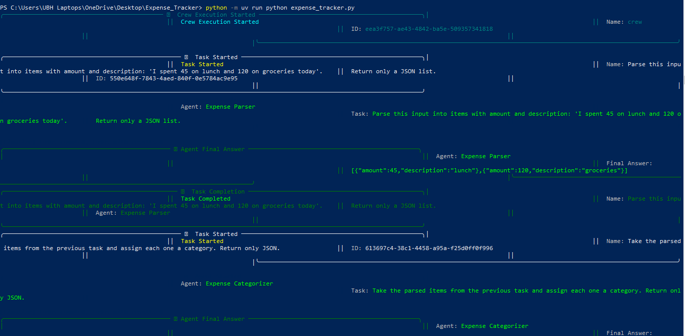
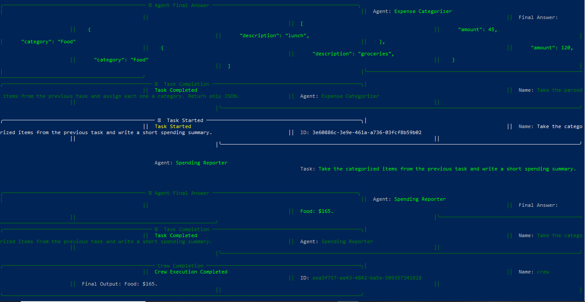
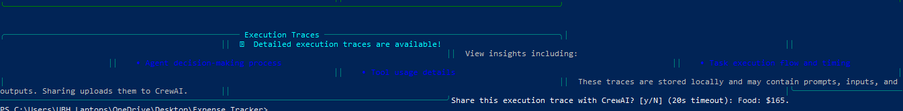

# Expense Tracker (Multi-Agent System)





I built this little project to get the hang of CrewAI. Basically, you just type a normal sentence about what you bought, and three AI agents pass the info down the line to figure out what you spent and give you a quick summary. 

## How it works

It’s just a straight chain of three agents:
1. **Parser**: Reads your sentence and pulls out the items and prices.
2. **Categorizer**: Slaps a label on each thing (Food, Transport, etc.).
3. **Reporter**: Adds it all up and writes the final summary.

## How to run it

1. Drop your Groq API key into a `.env` file:
   ```env
   GROQ_API_KEY=your_key_here
   ```
2. Fire it up:
   ```bash
   uv run python expense_tracker.py
   ```

*A quick heads-up: I'm using Groq's `gpt-oss-120b` model. The library had a weird bug where it kept messing up the model name, so I had to hack it a bit with `custom_openai=True` and the double `openai/` prefix. But hey, it works!*
```